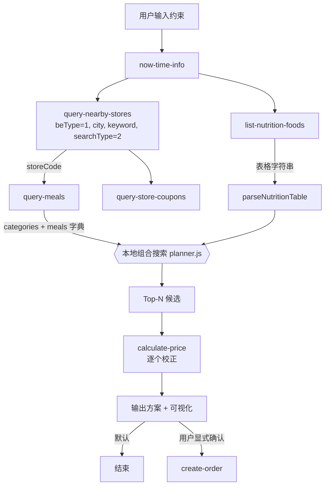

# MCP 集成说明

> 本文件说明本项目实际使用的麦当劳 MCP Server、Tool、调用流程与业务价值。
> **所有内容已于 2026-10-09 用真实 Token 完成线上校准**，标注 ⚠️ 处为与官方 README 文字描述不一致、以线上实际行为为准的要点。

## 1. 接入配置

| 项 | 值 |
|---|---|
| MCP Server | 麦当劳中国官方 MCP Server（线上 `serverInfo`: `mcd-mcp` v1.0.0） |
| 接入地址 | `https://mcp.mcd.cn` |
| 传输协议 | Streamable HTTP |
| 鉴权 | `Authorization: Bearer ${MCD_MCP_TOKEN}` |
| 限流 | 600 次/分钟（客户端侧保守设为 300 次/分钟，内置令牌桶） |
| 线上工具数 | **35 个**（官方 README 列表为 33 个，以线上 `tools/list` 为准） |

配置示例见 [`mcp-config.example.json`](./mcp-config.example.json)，**仅含环境变量占位符，不含任何真实凭据**。

### 关键业务参数（决定调用成败）

| 参数 | 取值 | 规则 |
|---|---|---|
| `beType` | 1=到店自取，2=麦乐送到家，5=得来速，6=企业团餐 | 必传 |
| `orderType` | 1=到店（含自取+得来速），2=外送（含麦乐送+团餐） | 与 beType 配对 |
| `beCode` | 与 storeCode 配对的业务编码 | **到店自取(beType=1)不传，传了会报错**；其余场景必传 |
| `storeCode` | 门店编码（纯数字） | 必填 |

本项目走**到店自取（beType=1 / orderType=1）**链路：无需用户配置配送地址，也不触碰地址簿，是隐私面最小、依赖最少的一条路径。

## 2. 实际使用的 Tools

| # | Tool | 作用 | 状态 |
|:--:|---|---|:--:|
| 1 | `now-time-info` | 校准服务端时间 | ✅ 已接通 |
| 2 | `query-nearby-stores` | 按城市+关键词查门店：`{beType, city, keyword, searchType}` | ✅ 已接通 |
| 3 | `query-meals` | 取门店实时菜单：`{storeCode, beType, orderType}` | ✅ 已接通 |
| 4 | `list-nutrition-foods` | 160 条餐品营养数据 | ✅ 已接通 |
| 5 | `query-store-coupons` | 门店可用优惠券 | ✅ 已接通（当前账号返回空） |
| 6 | `calculate-price` | **最终价格唯一准绳** | ✅ 已接通 |
| 7 | `create-order` | 下单（需显式二次确认） | 未启用（默认不下单） |

## 3. 调用流程



## 4. ⚠️ 实测校准要点（与文档描述不一致处）

这几点是踩过的坑，也是本项目最有复用价值的部分：

### 4.1 `query-meals` 的名称和价格不在同一个地方

返回结构为：

```jsonc
{
  "categories": [ { "name": "鸡肉汉堡/卷", "meals": [ { "code": "1440", "tags": [...] } ] } ],
  "meals": { "1440": { "name": "麦辣鸡腿汉堡", "currentPrice": "22.5", "image": "..." } }
}
```

- `categories[].meals[]` **只有 code 和 tags，没有名称和价格**
- 名称与价格在 `data.meals` 这个 **code → 详情的字典**里
- 单看任一部分都不完整，必须 join。实现见 `src/adapter.js` 的 `normalizeMenu()`

### 4.2 `list-nutrition-foods` 返回的不是 JSON

`data` 是自定义表格字符串：

```
[160]{productName,nutritionDescription,energyKj,energyKcal,protein,fat,carbohydrate,sodium,calcium}:
  猪柳麦满分,null,1288,308,16,16,24,781,213
```

首行声明条数与列名，其后按逗号分隔。热量字段名是 **`energyKcal`**（不是 `calories`）。解析见 `parseNutritionTable()`。

### 4.3 金额单位是「分」

`calculate-price` 返回 `price: 5100` 表示 **51.00 元**。必须除以 100。

### 4.4 字段名写错会静默返回 0（最危险的一条）

`calculate-price` 的 items 元素字段必须是 **`productCode`**。若误写为 `code`：

- 接口返回 `success: true`、`code: 200`
- 但 `price = 0`、`productList = []`

不报错、不抛异常，直接给出看似正常的 0 元。本项目在 `extractPrice()` 中**强制校验 `productList` 非空**，否则判定算价无效并在界面标注「未校验」，杜绝 0 元伪装成真实金额。

### 4.5 其他

- `query-nearby-stores` 的 `data` 是**数组**，不是 `{stores:[]}` 包装
- 到店自取场景 `beType=1` 时传 `beCode` 会报错 400
- `query-store-coupons` 实测返回空数组（当前账号/门店无可用券），UI 会明示「不含券后优惠」而非假装算了优惠

### 4.6 ⚠️ 菜单 `tags` 不能用来判断"是不是套餐"（2026-10-10 补）

原实现用 `menu.filter(x => x.tags.includes('套餐'))` 找套餐，实测**只命中 16 个**，而门店实际有 **56 个**套餐类商品。原因是 `tags` 覆盖不全：

| 商品 | 实际 tags |
|---|---|
| 麦辣鸡腿汉堡三件套 | `["套餐","立省10.5元起"]` ✅ 有"套餐" |
| **麦辣鸡腿堡四件套** | **`["麦金卡"]`** ❌ 没有"套餐" |

整个「四件套 / 随心选 / 麦金卡」系列都不带"套餐"标签。正确做法是**以名称特征为主、tags 只作补充**（见 `src/deal.js` 的 `isComboEntry`）：

```js
const COMBO_NAME_RE = /件套|套餐|组合|随心选|随心拼|单人餐|双人餐|多人餐|拼盘|乐园餐|超值|桶/;
```

漏判的后果不是"少推荐几个"，而是**整条主线算不出答案**——搜索「麦辣鸡腿堡」会得出"没有包含它的套餐"。

### 4.7 ⚠️ 无法单点的商品：靠官方算价判定，不要靠菜单

套餐组成里有些商品**根本不能单独下单**。`query-meal-detail` 会照常返回它们，但 `calculate-price` 对它们返回 `productList: []`：

| code | 名称 | 单独算价结果 |
|---|---|---|
| 3050 | 可乐中杯 | `productList: []` → 不可单点 |
| 515106 | 麦乐鸡4块 | `productList: []` → 不可单点 |
| 4810 | 中薯条 | 可单点 ¥14.5 |

判断"能否单点"要以 `calculate-price` 为准（返回空即不可单点），而不是"菜单里有没有"。本项目对这类商品**不计入任何金额**，只在结果里标注「套餐专属 · 无法单点」，因此净收益是**保守下界**。

### 4.8 ⚠️ 活动日历的 `price` 字段当前无有效值

`campaign-calendar` 的 `dailyList[].events[].price` 实测 **30 个活动全部为 `"0"`**（配 `priceSuffix: "起"`），
单位也无从验证。本项目**不展示活动价格**——宁可留白，也不猜一个数字出来。
活动标题、亮点与正文取自 `articleDto.title` / `highlights` / `content`，这些是有值的。

### 4.9 ⚠️ `query-meals` 的 category 有 15 个，需要归并后才能给用户看

实测门店菜单的 `category` 分布（15 类）：`鸡肉汉堡/卷` `巨无霸牛鱼肉堡` `安格斯MAX厚牛堡` `炸鸡`
`蘸酱炸鸡` `小食甜品/其他` `麦咖啡™` `饮品` `精选单人餐` `500大卡套餐` `大堡口福单人餐` `随心配1+1`
`小食拼盘/多人餐` `开心乐园` `人气热卖`。

直接抛给用户太碎（"想吃汉堡"要横跨 3 个分类）。本项目在 `src/catalog.js` 里归并成 8 个大类，
匹配用 `includes` 而非全等，避免官方微调分类名导致整类静默丢失。

### 4.10 ⚠️ 菜单展示价 ≠ 官方算价（会员价口径）

同一商品两个价格源会打架：

| 商品 | 菜单 `currentPrice` | `calculate-price` |
|---|---|---|
| 麦辣鸡腿堡四件套 | ¥28（tags 含"麦金卡"，疑为会员价） | **¥57** |
| 板烧鸡腿堡四件套 | ¥28 | **¥57** |

本项目**一律以官方算价为准**，但当两者相差 ≥¥1 时，会在结果卡片显式标注差额与"若你享该优惠实际更划算"，避免对会员用户造成误导——不静默给出看似正常的结论。

## 5. 调用链实现位置

| 环节 | 文件 |
|---|---|
| MCP 协议客户端（initialize / tools/list / tools/call） | `src/mcp-client.js` |
| 返回结构适配 + 表格解析 + 金额提取 | `src/adapter.js` |
| 组合搜索与多目标打分（按线上真实分类名分桶） | `src/planner.js` |
| **主线：买套餐 vs 单点的路径对比引擎** | `src/deal.js` |
| 编排与 HTTP 服务 | `src/server.js` |
| 前端展示 | `public/app.js` |
| 线上结构探测 | `scripts/probe.js` |
| 套餐组成/逐项算价调试 | `scripts/inspect-combo.js` |

## 5.5 官方图片资源（可直接引用）

两个 CDN，**实测均无防盗链，可直接 `` 引用**（2026-10-12 验证，均返回 200）：

| 来源 | 字段名 | 域名 | 样例 | 覆盖 |
|---|---|---|---|---|
| 商品/套餐图 | `query-meals` → `data.meals[code].image` | `menu-img.mcd.cn` | `.../product/MS_1100_320.png` | **128/128** |
| 活动图 | `campaign-calendar` → `dailyList[].events[].articleDto.imgList[0]` | `cms-cdn.mcd.cn` | `.../553a0a73...b90.jpg` | 26/26 |
| 券图 | `available-coupons` → `couponImage` | — | — | 7/7 |

注意：
- 商品图尺寸后缀为 `_320`，单张 40~150 KB，数量多时务必加 `loading="lazy"`
- 前端写入 `img.src` 前应校验协议为 http(s)，避免外部数据塞入 `javascript:` 之类
- 图片失败时隐藏而非显示破图占位

## 6. 实跑验证结果（2026-10-09）

门店：麦当劳杭州黄龙万科中心餐厅（storeCode `3330254`）
菜单 128 项 · 营养 160 条 · 优惠券 0 张

| 方案 | 组合（2 人份） | 本地估算 | 官方算价 | 人均热量 | 人均蛋白质 |
|---|---|---:|---:|---:|---:|
| 1 | 双层深海鳕鱼堡 ×2 + 圆筒冰淇淋 ×2 | ¥58.00 | **¥58.00** | 578 kcal | 30 g |
| 2 | 双层深海鳕鱼堡 ×2 + 新地 ×2 | ¥72.00 | **¥72.00** | 767 kcal | 33 g |
| 3 | 巨无霸 ×2 + 圆筒冰淇淋 ×2 | ¥61.00 | **¥61.00** | 606 kcal | 29 g |
| 4 | 双层吉士汉堡 ×2 + 圆筒冰淇淋 ×2 | ¥56.00 | **¥56.00** | 522 kcal | 29 g |
| 5 | 芝士安格斯厚牛堡 ×2 + 韩式烟熏芝士风味酱 ×2 | ¥69.00 | **¥69.00** | 696 kcal | 32 g |

**本地估算与官方 `calculate-price` 结果 5/5 完全一致** —— 说明估算逻辑未偏离官方计价规则；即便如此，界面仍以官方算价为准显示。

### 6.1 主线实跑结果（2026-10-10，v3「怎么买更划算」）

门店：麦当劳杭州国大城市广场餐厅（storeCode `3330387`），到店自取链路，扫描 **56 个**套餐类商品。

**想吃：麦辣鸡腿堡**（菜单里真名单品叫「麦辣鸡腿汉堡」，靠归一化匹配命中）

| 购买路径 | 官方价 | 多花 | 多得估值 | 净收益 | 结论 |
|---|---:|---:|---:|---:|---|
| 单点 麦辣鸡腿汉堡 | ¥22.5 | — | — | — | 基准 |
| **麦辣鸡腿汉堡三件套** | ¥33.5 | ¥11.0 | ¥14.5（中薯条） | **+¥3.5** | ✅ 主推荐 |
| 麦麦周末双人餐 | ¥49.9 | ¥27.4 | ¥36.5 | +¥9.1 | 加价升级备选（双人份） |
| 麦辣鸡腿堡四件套 | ¥57.0 | ¥34.5 | ¥14.5 | −¥20.0 | 单点划算（菜单价 ¥28，见 4.8） |
| 堡堡随心拼（7件任选） | ¥72.5 | ¥50.0 | ¥14.5 | −¥35.5 | 单点划算 |

**想吃：巨无霸**

| 购买路径 | 官方价 | 多花 | 净收益 | 结论 |
|---|---:|---:|---:|---|
| 单点 巨无霸 | ¥26.5 | — | — | 基准 |
| **巨无霸三件套** | ¥37.5 | ¥11.0 | **+¥3.5** | ✅ 主推荐 |
| 巨无霸四件套 | ¥58.5 | ¥32.0 | −¥17.5 | 单点划算 |

全程 2.5~3.8 秒，官方算价 0 失败，无 warnings；营养附加覆盖率 3/3。

## 7. 业务价值

1. **对用户**：把「凑满减 + 算热量 + 选搭配」的人工试错，压缩为一次输入、5 个可直接比对的方案。
2. **对麦当劳 MCP 生态**：验证了「菜单 + 营养 + 优惠券 + 算价」四类工具可被编排成完整决策链路，而非单点查询；并把上述 5 个真实对接坑点公开出来，降低后续开发者的接入成本。
3. **对开发者**：提供零第三方依赖接入 MCP Streamable HTTP 的最小实现（SSE 与 JSON 双响应解析、会话维持、限流节流），可直接复制复用。

## 8. 容错与降级

`src/server.js` 中每一步 MCP 调用都被 `step()` 包裹：单步失败不中断整体流程，而是写入 `warnings` 并在页面如实展示。**宁可明示数据缺失，也不静默返回看起来正常的错误结果。**
